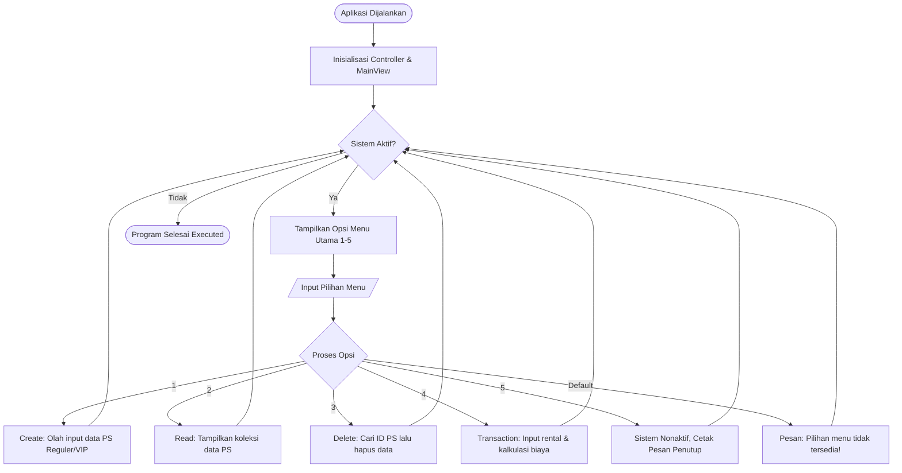

## 1. Ringkasan Singkat Project

**Sistem Pengelolaan Rental PS** merupakan aplikasi berbasis terminal yang dirancang untuk memudahkan pemilik usaha rental dalam mendata unit console PlayStation serta memproses riwayat persewaan. Aplikasi ini menyediakan operasi utama berbasis **CRUD**:

| Opsi Menu | Nama Fitur | Fungsi & Deskripsi |
|-----------|------------|--------------------|
| 1 | Tambah Unit PS | **Create** - Menambahkan data unit PS baru (Pilihan kategori Reguler / VIP) |
| 2 | Daftar Unit PS | **Read** - Menampilkan seluruh unit PS yang terdaftar dalam bentuk daftar rapi |
| 3 | Hapus Unit PS | **Delete** - Menghapus data unit PS berdasarkan kode ID unik |
| 4 | Transaksi Rental | **Transaction** - Memproses penyewaan unit serta menghitung biaya otomatis |
| 5 | Keluar Aplikasi | Menutup dan mengakhiri jalannya program |

Unit console dikelompokkan ke dalam 2 kategori fasilitas:

- **PS Reguler** -> Ditujukan untuk penggunaan standar, dilengkapi atribut tambahan **jumlah stik bawaan**.
- **PS VIP** -> Ditujukan untuk penggunaan eksklusif, dilengkapi atribut tambahan **fasilitas ruangan VIP**.

Seluruh data disimpan secara sementara dalam struktur data `ArrayList<Console>`, sehingga pengelolaan data bersifat dinamis selama program berjalan.

---

## 2. Arsitektur dan Struktur Package (MVC)

Proyek ini menerapkan arsitektur **MVC (Model - View - Controller)** untuk memisahkan logika utama program dengan tampilan interaksi pengguna:

```text
Minpro-3-PBO-ManajemenRentalPS/
└── src/
    ├── model/
    │   ├── Console.java
    │   ├── PSReguler.java
    │   ├── PSVIP.java
    │   ├── Pelanggan.java
    │   └── Rental.java
    ├── controller/
    │   ├── Diskonable.java
    │   ├── PSController.java
    │   └── RentalController.java
    ├── view/
    │   └── MainView.java
    └── main/
        └── Main.java
```

| Package | File | Peran & Tanggung Jawab |
|---------|------|------------------------|
| model | Console.java | Abstract Class - Superclass untuk atribut & method dasar unit console |
| model | PSReguler.java | Subclass - Turunan Console dengan atribut khusus jumlahStik |
| model | PSVIP.java | Subclass - Turunan Console dengan atribut khusus fasilitasVIP |
| model | Pelanggan.java | Model entitas penampung identitas pelanggan |
| model | Rental.java | Model entitas penampung data transaksi persewaan |
| controller | Diskonable.java | Interface - Kontrak perhitungan biaya rental & diskon |
| controller | PSController.java | Pengelola koleksi unit PS (pencarian, penambahan, penghapusan) |
| controller | RentalController.java | Pengelola transaksi rental & pengimplementasi interface Diskonable |
| view | MainView.java | Antarmuka pengguna CLI, navigasi menu, dan validasi input keyboard |
| main | Main.java | Main Entry Point untuk menjalankan aplikasi |'''


---

## 3. Jalannya Alur Program (Menu 1 sampai 5)

### 3.1 Flowchart / Diagram Alur



## 4. Penerapan Konsep PBO Dasar
### 4.1 Validasi Input Data
Penggunaan penanganan input berbasis angka untuk mencegah crash akibat masukan yang tidak sesuai.

Pembatasan nilai input tarif sewa minimal (min. Rp5.000/jam).

Pengecekan keberadaan ID unit PS saat melakukan penghapusan atau transaksi.

### 4.2 Access Modifier
private: Digunakan pada seluruh atribut model agar tidak dapat dimodifikasi langsung dari luar kelas.

public: Digunakan pada constructor, getter, setter, dan method kontrol utama agar bisa dipanggil antar-package.

### 4.3 Encapsulation (Proteksi Data)
Setiap atribut dikunci dengan akses `private` dan hanya bisa dimanipulasi secara aman via metode `getter` dan `setter`. Atribut pembeda unik seperti `id` dilengkapi keyword `final` sehingga sifatnya *immutable* (tidak bisa diubah sesudah diinisialisasi).

### 4.4 Inheritance (Pewarisan)
Penerapan struktur pewarisan dari 1 superclass ke 2 subclass:

```text
                  ┌──────────────────────────────┐
                  │   Console (Abstract Class)   │
                  │ - id (final)                 │
                  │ - jenis                      │
                  │ - hargaPerJam                │
                  └──────────────┬───────────────┘
                                 │
                 ┌───────────────┴───────────────┐
                 │                               │
┌────────────────┴───────────────┐ ┌─────────────┴────────────────┐
│           PSReguler            │ │             PSVIP              │
│ + jumlahStik (final)           │ │ + fasilitasVIP (final)         │
└────────────────────────────────┘ └────────────────────────────────┘
```


## 5. Penerapan Abstraction dan Polymorphism
### 5.1 Abstraction (Abstract Class & Method)


Kelas Console dideklarasikan sebagai abstract class yang tidak bisa dibuat objeknya secara langsung. Kelas ini memuat metode abstrak:

public abstract void displayInfo();

## 6. Penjelasan Nilai Tambah
Nilai tambah yang diimplementasikan pada proyek ini yaitu penggunaan Interface:


Diskonable.java berperan sebagai kelas interface yang memuat acuan kalkulasi biaya rental.

Kelas RentalController menerapkan aturan interface tersebut menggunakan klausa implements Diskonable.

## 7. Output Program


=== SISTEM MANAJEMEN RENTAL PS ===
1. Tambah PS (Reguler/VIP)
2. Tampilkan Daftar PS
3. Hapus PS
4. Transaksi Rental PS
5. Keluar
Pilih menu:
